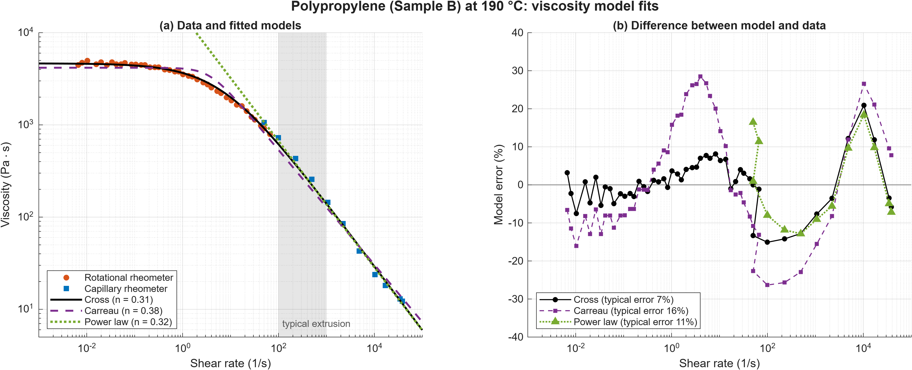
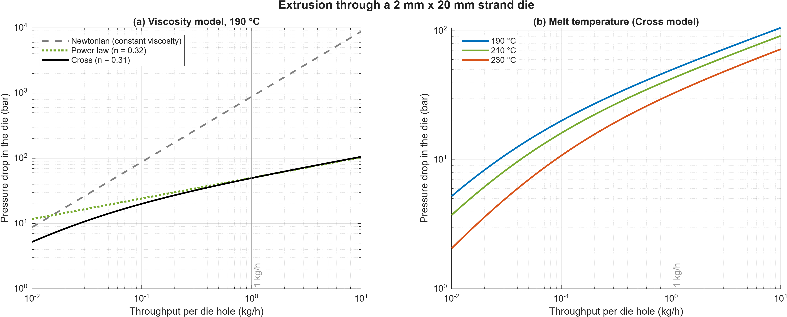

# Polymer Melt Rheology: From Viscosity Data to Extrusion Design

## Overview

How easily a molten plastic flows decides how it can be processed: how hot it must be, how fast it can be extruded, and how much pressure the machine needs. This project analyzes published rheology data for two polypropylene (PP) melts in MATLAB to:

1. Quantify how temperature changes melt viscosity (time-temperature superposition and flow activation energy)
2. Fit standard viscosity models (power-law, Cross, Carreau) to a flow curve covering more than six orders of magnitude in shear rate
3. Use the fitted model to estimate the pressure needed to push the melt through an extrusion die

## Key findings

- Between 190 and 230 °C, the zero-shear viscosity of polypropylene falls by a factor of 3.3. Between 190 and 210 °C the flow activation energy is 42 kJ/mol, close to literature values.
- The Cross model describes the flow curve over more than six orders of magnitude in shear rate with a typical error of 7% (n = 0.31, λ = 0.15 s).
- Pushing 1 kg/h of melt through a 2 mm strand die needs about 50 bar at 190 °C. Without shear thinning, it would need about 876 bar.

## Data

All data come from the NETZSCH application note *Polymers and Temperature – A Hot Relationship* (AN 297, Strasser & Gezgin, 2023):

| Sample | Source | Conditions | Used for |
|---|---|---|---|
| A | Figure 1 | Rotational rheometer (cone-plate), 190-230 °C, nitrogen | Temperature dependence |
| B | Figure 5 | Rotational + capillary rheometer, 190 °C | Viscosity model fitting |

Values were read from the published figures with WebPlotDigitizer (`data/raw/`) and converted to clean tables by `scripts/prepare_data.m` (`data/processed/`). For Sample A, only shear rates up to 4 s⁻¹ are used: above that, the melt is pushed out of the rheometer gap and the measured viscosity is not reliable.

## Results

### 1. Effect of temperature (Sample A)

*(a) Measured viscosity at five temperatures. (b) Master curve: each curve shifted by its shift factor a_T onto the 190 °C reference. (c) Arrhenius plot of the shift factors.*

- Between 190 and 230 °C, the zero-shear viscosity falls from 1,684 to 511 Pa·s, so the melt becomes about 3.3 times more fluid.
- All five curves collapse onto one master curve, so time-temperature superposition holds for this polypropylene.
- Between 190 and 210 °C, the flow activation energy is 42 kJ/mol, close to the 40 ± 1 kJ/mol reported for polypropylene by Fambri et al. (2008).
- At 220 and 230 °C, the viscosity drops faster than the Arrhenius equation predicts, which raises the apparent activation energy to 57 kJ/mol. This is consistent with thermal degradation (chain scission) at high temperature, but the data alone cannot confirm it.

### 2. Viscosity model fitting (Sample B)

*(a) Flow curve of Sample B at 190 °C from a rotational rheometer (orange) and a capillary rheometer (blue), with three fitted viscosity models. The shaded band marks typical extrusion shear rates (about 100-1000 s⁻¹). (b) Difference between each model and the data.*

| Model | η₀ (Pa·s) | λ (s) | n | K (Pa·sⁿ) | Typical error |
|---|---|---|---|---|---|
| Power law (≥ 50 s⁻¹ only) | - | - | 0.32 | 15,600 | 11% |
| Cross | 4,646 | 0.15 | 0.31 | - | 7% |
| Carreau | 4,170 | 0.27 | 0.38 | - | 16% |

- The viscosity falls by a factor of almost 400, from about 4,600 Pa·s on the plateau to about 12 Pa·s at 38,500 s⁻¹. This strong shear thinning is typical of polypropylene.
- The Cross model fits best over the whole range (typical error 7%). Its time constant λ ≈ 0.15 s means shear thinning starts at about 1/λ ≈ 7 s⁻¹: above this rate, the polymer chains no longer have time to relax and start to align with the flow.
- The Carreau model bends from the plateau into shear thinning too sharply for this polymer, with errors of up to about 28%.
- The power law describes the high-shear region well (n ≈ 0.32) but has no plateau, so it predicts unrealistically high viscosities at low shear rates.
- In the extrusion range, the Cross and power-law models predict viscosities 8-15% below the capillary data. One reason is that the rotational and capillary measurements differ by about 13% where they overlap (around 50 s⁻¹).

### 3. Extrusion die pressure drop

*Pressure needed to push Sample B through a circular strand die (2 mm diameter, 20 mm long), calculated with the Rabinowitsch-Mooney equation for fully developed, isothermal flow. (a) Effect of the viscosity model at 190 °C. (b) Effect of melt temperature, using the Cross model shifted with the shift factors from Sample A. Melt density assumed to be 750 kg/m³.*

| Case (1 kg/h per die hole) | Pressure drop | Wall shear rate |
|---|---|---|
| Newtonian, 190 °C | 876 bar | 472 s⁻¹ |
| Power law, 190 °C | 50 bar | 727 s⁻¹ |
| Cross, 190 °C | 50 bar | 694 s⁻¹ |
| Cross, 210 °C | 42 bar | - |
| Cross, 230 °C | 32 bar | - |

- Shear thinning is what makes extrusion practical: if the melt kept its plateau viscosity, the die would need about 17 times more pressure.
- In the extrusion range, the power law and Cross models give the same pressure, so the simpler power law is good enough for die design. At low throughputs the power law overestimates the pressure, because it ignores the plateau.
- Raising the melt temperature from 190 to 230 °C lowers the zero-shear viscosity by 70%, but the die pressure by only about 35%. At high shear rates temperature matters less: for a power-law fluid the pressure scales with a_T to the power n, and with n ≈ 0.31 this effect is damped.
- Because the models predict 8-15% lower viscosities than the capillary data in this range (Section 2), the real pressure is probably 10-15% higher than calculated.

## Limitations

- All values were read from published figures with WebPlotDigitizer, so they carry a digitizing error of a few percent.
- NETZSCH does not name the polypropylene grades. The temperature behavior of Sample A was applied to Sample B, which assumes both respond to temperature in the same way.
- For Sample A, only shear rates up to 4 s⁻¹ could be used, because the melt is pushed out of the rheometer gap at higher rates.
- The rotational and capillary data for Sample B differ by about 13% where they overlap, and it is not stated which corrections were applied to the capillary data.
- The die calculation assumes fully developed, isothermal flow without wall slip. It ignores entrance and exit pressure losses and heating of the melt by friction, so a real die would need more pressure.
- Thermal degradation at 220-230 °C is a possible explanation for the deviation from Arrhenius behavior, not a confirmed one.

## Conclusion

Polypropylene melts shear-thin strongly: between the plateau and typical processing rates, their viscosity drops by more than two orders of magnitude. Time-temperature superposition holds between 190 and 230 °C, and the Cross model captures the full flow curve with a single set of parameters. In a die design calculation, shear thinning lowers the required pressure about 17-fold compared with a Newtonian melt, while raising the melt temperature has a much smaller effect at extrusion rates than at rest.

## How to reproduce

1. Download or clone this repository.
2. Open MATLAB and run the scripts in the `scripts/` folder, in this order:
   - `prepare_data.m`: converts the digitized raw data into clean tables
   - `analyze_temperature.m` → Graph 1 (temperature dependence)
   - `fit_models.m` → Graph 2 (viscosity model fits)
   - `die_pressure.m` → Graph 3 (extrusion die pressure)
3. Each script reads from `data/processed/` and saves its figure to `figures/`.

## Author

Gabija Gasilionyte: chemical engineering student at Case Western Reserve University.
Background for this project: MIT OpenCourseWare, [3.064 Polymer Engineering](https://ocw.mit.edu/courses/3-064-polymer-engineering-fall-2003) (self-study).
