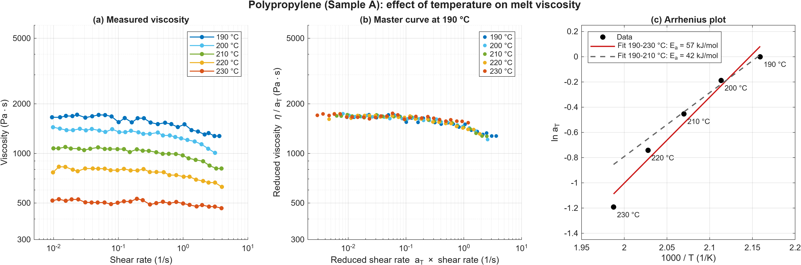

# Polymer Melt Rheology: From Viscosity Data to Extrusion Design

*Work in progress*

## Overview

How easily a molten plastic flows decides how it can be processed: how hot it must be, how fast it can be extruded, and how much pressure the machine needs. This project analyzes published rheology data for two polypropylene (PP) melts in MATLAB to:

1. Quantify how temperature changes melt viscosity (time-temperature superposition and flow activation energy)
2. Fit standard viscosity models (power-law, Cross, Carreau) to a flow curve covering more than six orders of magnitude in shear rate
3. Use the fitted model to estimate the pressure needed to push the melt through an extrusion die

## Data

All data come from the NETZSCH application note *Polymers and Temperature – A Hot Relationship* (AN 297, Strasser & Gezgin, 2023):

| Sample | Source | Conditions | Used for |
|---|---|---|---|
| A | Figure 1 | Rotational rheometer (cone-plate), 190-230 °C, nitrogen | Temperature dependence |
| B | Figure 5 | Rotational + capillary rheometer, 190 °C | Viscosity model fitting |

Values were read from the published figures with WebPlotDigitizer (`data/raw/`) and converted to clean tables by `scripts/prepare_data.m` (`data/processed/`). For Sample A, only shear rates up to 4 s⁻¹ are used: above that, the melt is pushed out of the rheometer gap and the measured viscosity is not reliable.

## Results

### 1. Effect of temperature (Sample A)

*(a) Measured viscosity at five temperatures. (b) Master curve: each curve shifted by its shift factor a_T onto the 190 °C reference. (c) Arrhenius plot of the shift factors.*

- Between 190 and 230 °C, the zero-shear viscosity falls from 1,684 to 511 Pa·s, so the melt becomes about 3.3 times more fluid.
- All five curves collapse onto one master curve, so time-temperature superposition holds for this polypropylene.
- Between 190 and 210 °C, the flow activation energy is 42 kJ/mol, close to the 40 ± 1 kJ/mol reported for polypropylene by Fambri et al. (2008).
- At 220 and 230 °C, the viscosity drops faster than the Arrhenius equation predicts, which raises the apparent activation energy to 57 kJ/mol. This is consistent with thermal degradation (chain scission) at high temperature, but the data alone cannot confirm it.

## Planned analysis

2. Viscosity model fitting (Sample B)
3. Extrusion die pressure drop
